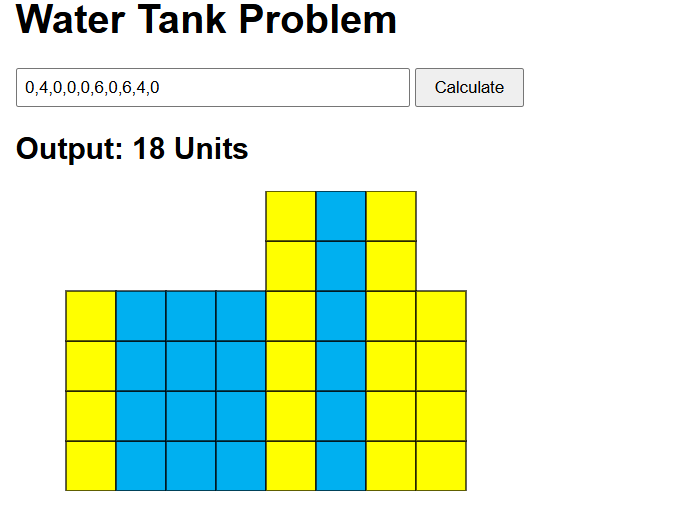

# Water Tank Problem

A small web app that shows how much water is stored between blocks.
Built with plain HTML, CSS and JavaScript (no libraries).

## The problem

You are given a list of numbers. Each number is the height of a block.
After rain, water collects in the gaps between the blocks.
The app calculates how many units of water are stored and draws the result.

**Example**

- Input: `0,4,0,0,0,6,0,6,4,0`
- Output: `18 Units`

## Screenshot

- Yellow squares = blocks
- Blue squares = water

## How to run

1. Download or clone this repository.
2. Open `index.html` in any browser.

That is all. No install or build step is needed.

You can also use the Live Server extension in VS Code.

## How to use

1. Type block heights separated by commas, for example `3,0,3`.
2. Click **Calculate**.
3. The total water and the drawing appear below.

Only whole numbers that are 0 or more are accepted. Anything else shows an error message.

## How it works

For each position, the water on top of it is:

> the smaller of (tallest block on its left, tallest block on its right) minus its own height

Steps:

1. Go from left to right and note the tallest block seen so far at each position.
2. Go from right to left and do the same.
3. For each position, take the smaller of the two values and subtract the block height.
4. Add all the values to get the total.

Time taken grows in a straight line with the number of blocks. It uses two extra lists.

## Files

| File | Purpose |
|---|---|
| `index.html` | Page layout |
| `style.css` | Basic styling |
| `script.js` | Water calculation and SVG drawing |
| `screenshot.png` | Sample output |

## Test cases

| Input | Output |
|---|---|
| `0,4,0,0,0,6,0,6,4,0` | 18 |
| `3,0,3` | 3 |
| `1,2,3,4` | 0 |
| `0,0,0` | 0 |
| `5` | 0 |
